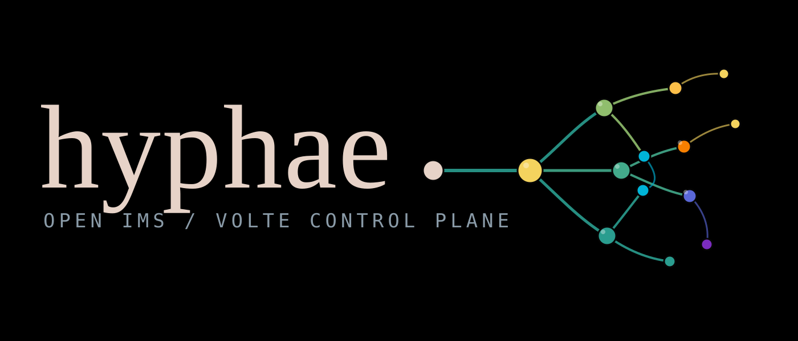

<p align="center">
  
</p>

<p align="center">
  <b>The AP-side IMS stack that Linux phones never got.</b><br>
  Spec-derived SIP, IMS-AKA, SDP and a codec-agnostic media boundary.
</p>

<p align="center">
  <a href="LICENSE"></a>
  
  
  
</p>

---

hyphae is a GPL-3.0-or-later, specification-derived IMS/VoLTE client for Linux
phones. When 2G and 3G were switched off, Linux phones lost voice, because the
AP-side IMS stack has never been open source. This repository is the missing
control plane: SIP, IMS-AKA, registration, dialogs, SDP, carrier profiles, the
Gm security plane, and a codec-agnostic media boundary.

Nothing here opens a socket, starts a thread or links a codec by default, so the
whole protocol surface builds and tests on a laptop with no modem and no network.

## Status

The requirement → clause → test → crate matrix in
[`docs/specs.md`](docs/specs.md) is green: every implemented row names its
normative clause and the executable test that proves it.

| Area | State |
| --- | --- |
| Registration, IMS-AKA, USIM (`REG-*`, `AKA-*`, `USIM-001`) | implemented |
| Mobile-originated and mobile-terminated calls, CANCEL, PRACK, BYE (`INV-*`, `UAS-*`) | implemented |
| Hold/resume, call waiting, re-INVITE/UPDATE renegotiation (`SUP-*`) | implemented |
| Voice continuity: EPS fallback classification, media-liveness monitor (`VOICE-*`) | implemented |
| Wi-Fi calling core: EAP-AKA' key hierarchy and AT framing (`EPDG-001`) | implemented; IKEv2/ePDG tunnel pending |
| Forked INVITE, OPTIONS keepalive (`INV-004`, `KEEP-001`) | implemented |
| SMS over IMS, both directions (`SMS-*`) | implemented |
| Gm IPsec: authenticated ESP, SA negotiation, Linux XFRM (`SEC-002..004`) | implemented |
| Media framing: RTP/RTCP, jitter buffer, PLC (`MEDIA-001`) | implemented |
| Call-audio seam: ring buffer, loopback, WAV capture, pacing (`AUDIO-001`) | implemented; device adapter out of tree |
| Payload formats: RFC 4867 AMR-WB, TS 26.445 EVS (`RTP-*`, `EVS-001`) | implemented |
| Modem backends: AT/QMI, MBIM, CCCI boundary (`TRN-*`) | modelled / boundary |
| USIM access: software, PC/SC boundary, QMI UIM Send APDU, AT+CSIM (`USIM-*`) | implemented |
| Emergency (E911) request construction (`E911-001`) | implemented, never transmitted |
| Byte-level modem I/O, live emergency calling | out of tree / product gate |

The two hardware boundaries are defined and tested, not guessed at: a
`VendorChannel`/`ApduChannel` adapter plugs in for CCCI and PC/SC, and the AT/QMI
byte I/O is the only modem-specific piece left.

## Why it matters

- VoLTE/IMS is the only voice path left on many networks, and there is no libre
  AP-side client to put on a Linux phone.
- The modem side (QMI/MBIM/CCCI), the network side (Open5GS/Kamailio) and the OS
  side all exist. The client is the gap.
- Protocol work stays independent of patent-encumbered codecs, so the GPL core
  can be built, tested and distributed without a codec royalty.

## Architecture

```text
  ims state machine ── sip::Message ──► Transport ──► UDP/TCP, MBIM, AT/QMI, CCCI
        │                    │
        │                    └─ sip/    messages, headers, transactions (no I/O)
        ├─ aka/ + usim/  Milenage, AUTN, USIM AUTHENTICATE (no I/O)
        ├─ carrier/      MCC/MNC profiles → ImsProfile
        ├─ media/        RTP/RTCP, jitter buffer, PLC
        └─ codec/ + codec-amr/ + evs/   PCM in, PCM out; payload formats only
```

| Crate | Contents |
| --- | --- |
| `sip` | RFC 3261 messages, headers, client/server transactions; no I/O |
| `aka` | Milenage f1–f5, AUTN verification, RFC 3310 RES, EAP-AKA' keys; pure functions |
| `usim` | TS 31.102 `AUTHENTICATE`, card boundary, QMI UIM / AT+CSIM adapters, software USIM |
| `ims` | profile, REGISTER/401/407, SDP, dialogs, MO/MT calls, SMS, E911, continuity |
| `carrier` | TOML profiles keyed by MCC/MNC, plus lab profile `00101` |
| `codec` | `Codec` trait and optional Opus (feature `opus`); PCM only |
| `codec-amr` | RFC 4867 payload format and optional AMR-WB FFI (separate package) |
| `evs` | TS 26.445 appendix A EVS payload format; no codec |
| `media` | RFC 3550 RTP/RTCP, jitter buffer, PLC, call-audio seam |
| `transport` | mock, UDP/TCP, ESP/IPsec, AT/QMI + MBIM PDN, CCCI boundary |
| `tests/conformance` | spec-derived conformance harness with cited clauses |
| `lab` | Open5GS + Kamailio IMS plan, plus a runnable local P-CSCF |

## Quickstart (host, no modem, no network)

```sh
cargo check --workspace
cargo test --workspace

cargo run -p ims --example register_flow
cargo run -p ims --example call_flow
```

`register_flow` prints the exact initial REGISTER, a simulated 401 and the
authorized REGISTER with an AKAv1-MD5 digest. `call_flow` drives the caller
state machine through a full INVITE/183/PRACK/200/ACK/BYE ladder. Both use the
in-memory mock transport; neither touches the network.

The lab-only CLI exercises the same paths:

```sh
cargo run -p hyphae-cli -- show-profile
cargo run -p hyphae-cli -- register --transport mock --imsi 001010000000001
cargo run -p hyphae-cli -- emergency --transport mock   # prints, never sends
```

### Local REGISTER against a real socket

```sh
cd lab/pris && ./run.sh
```

`lab/pris` runs the full REGISTER ladder over real UDP against a P-CSCF
stand-in that verifies the AKAv1-MD5 digest; no Docker or USIM required.

### The ARM gate

```sh
rustup target add aarch64-unknown-linux-gnu
rustup target add armv7-unknown-linux-gnueabihf
make arm        # or: cargo check --workspace --target <triple>
```

We can type-check ARM locally; we cannot run ARM tests on this host. See
[`docs/targets.md`](docs/targets.md) for exactly what is and is not verified.

### Optional codecs

```sh
cargo test -p codec --features opus          # royalty-free, in tree
cargo test -p codec-amr                      # RFC 4867 payload format, no C
cargo test -p evs                            # TS 26.445 payload format, no C
cargo test -p codec-amr --features amr-wb    # system libopencore-amrwb (patents NOT granted)
cargo check -p codec-amr --features amr-wb-dlopen
```

AMR-WB cross-builds need a target sysroot and `PKG_CONFIG_ALLOW_CROSS=1` or
`OPENCODE_AMR_DIR`; see [`codec-amr/README.md`](codec-amr/README.md). Read
[`codec-amr/PATENTS.md`](codec-amr/PATENTS.md) and the root [`PATENTS.md`](PATENTS.md)
before enabling it.

## The lab

The full Open5GS + Kamailio IMS lab is a plan plus a compose file; it has not
been run in this repository. Steps, the expected REGISTER ladder and success
criteria are in [`lab/README.md`](lab/README.md):

```sh
cd lab
cp .env.example .env
# Add the upstream Open5GS and Kamailio IMS configs under lab/config/.
docker compose up -d
```

Success looks like: initial REGISTER with `Security-Client` → 401 with
`WWW-Authenticate: ... algorithm=AKAv1-MD5` → REGISTER with
`Authorization: Digest ...` → 200 OK with `Service-Route`. Your K/OP must match
between the programmable USIM and the HSS. Use test credentials only.

## Documentation

- [`docs/specs.md`](docs/specs.md) — requirement → clause → test → crate matrix.
- [`docs/architecture.md`](docs/architecture.md) — crate boundaries, codec
  licensing, transport backends, and the Gm security plane.
- [`docs/targets.md`](docs/targets.md) — the ARM gate and its limits.
- [`docs/references.md`](docs/references.md) — legal provenance and reference terms.
- [`docs/adr/0001-codec-licensing.md`](docs/adr/0001-codec-licensing.md) — the
  binding codec-licensing decision.
- [`docs/facts/`](docs/facts/) — provenance-only vendor facts; never code.

## Legal posture

1. This tree is GPL-3.0-or-later and contains **no** AMR-WB or EVS
   implementation; `codec` ships the `Codec` trait plus royalty-free Opus.
2. AMR-WB lives in a separate, feature-off, patent-noticed package
   ([`codec-amr/PATENTS.md`](codec-amr/PATENTS.md)); its Apache-2.0 library does
   **not** grant AMR-WB patent rights.
3. Retrofit mode runs the phone's own licensed codec on that unit; manufacture
   mode uses an ODM or our licensed build. Vendor blobs are never redistributed.
4. No code, strings or constants were derived from decompiled KaiOS/MTK/Qualcomm
   binaries; sources and licences are recorded in
   [`docs/references.md`](docs/references.md), and vendor facts (if any) live in
   [`docs/facts/`](docs/facts/) and never become code.
5. The binding decision is recorded in the project ADR, mirrored in-tree at
   [`docs/adr/0001-codec-licensing.md`](docs/adr/0001-codec-licensing.md).

## Contributing discipline

- Specs first: every behaviour needs a normative citation and a named test.
- No vendor-derived code, strings or constants. Facts go in `docs/facts/`.
- Keep the default build pure-Rust and ARM-buildable; C only behind a feature.
- No async runtime until the synchronous state machine is trusted.
- AMR-WB and EVS never enter a core crate; they stay behind the `Codec` trait in
  a separate, patent-noticed package.
